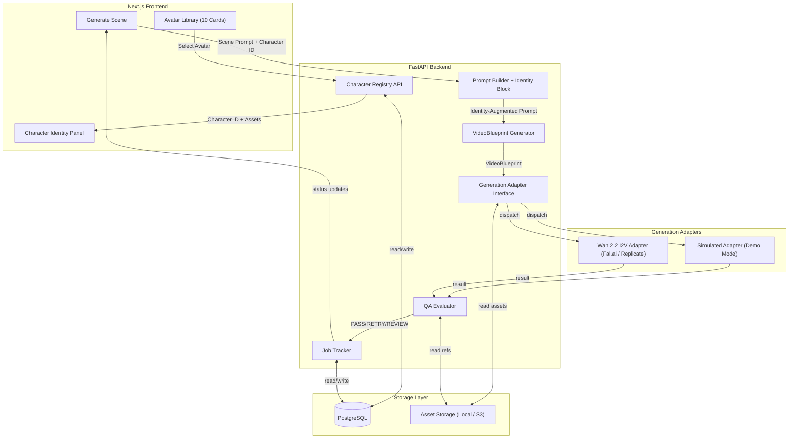
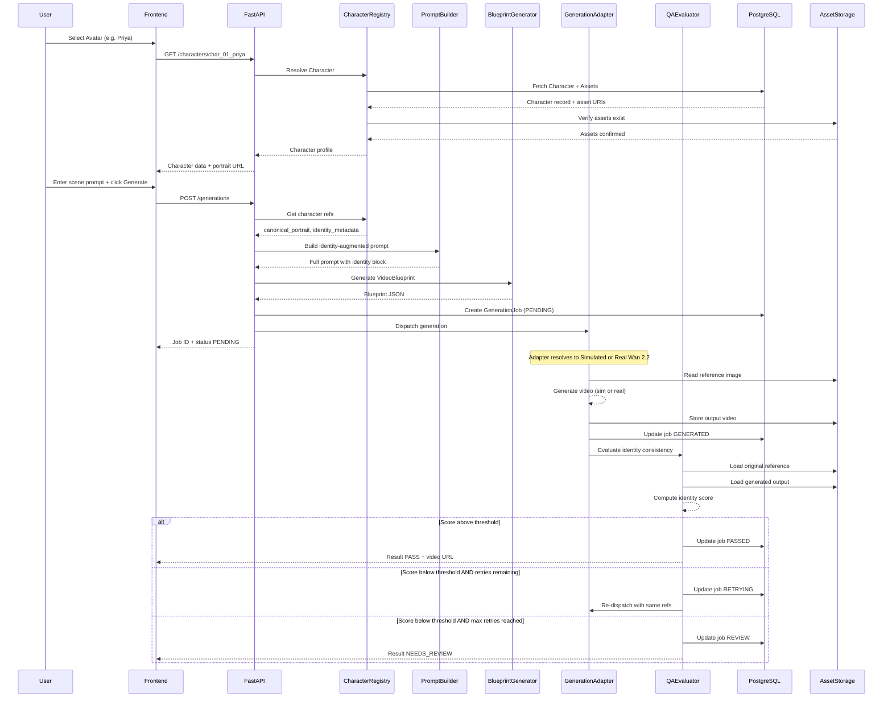
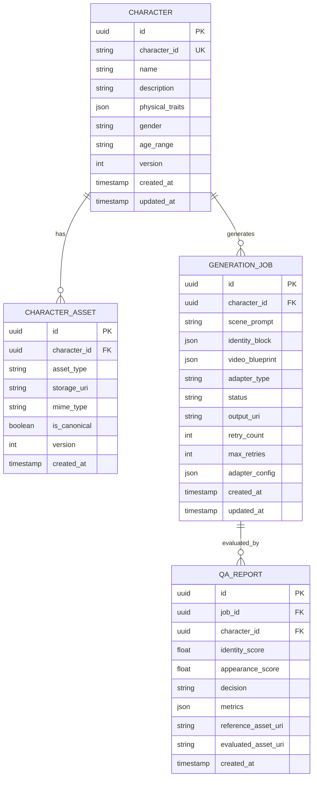
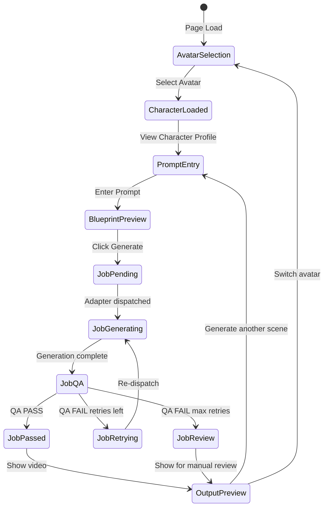

# Phase 1: Research Report & Implementation Plan
## 10-Avatar Character Identity Studio

> **Status: AWAITING APPROVAL — Do not proceed to implementation**

---

## 1. Executive Summary

This document presents the complete Phase 1 research, architecture, and implementation plan for building a **10-Avatar Character Identity Studio** — a focused demo that demonstrates persistent character identity management inspired by Higgsfield Soul ID, built on Wan 2.2 video generation.

### Key Findings

| Area | Finding |
|:-----|:--------|
| **Repository State** | Empty — contains only the research PDF. No existing codebase to integrate with. |
| **Higgsfield Soul ID** | Trains a LoRA/PEFT identity layer from 20-80 photos; proprietary internals. We can replicate the *user experience* without their proprietary training. |
| **Wan 2.2 Identity** | I2V-A14B and Animate-14B natively support reference-image conditioning as identity anchor — ideal for our 10 predefined avatars. |
| **Recommended Approach** | **Option E (Hybrid)**: Canonical reference image + fixed identity prompt + simulated adapter for demo, with architecture supporting real Wan 2.2 I2V integration. |
| **Stack** | FastAPI + PostgreSQL + Next.js + S3-compatible storage |
| **Estimated Effort** | ~10.5 working days for full demo |

---

## 2. Current Project Audit

### 2.1 Repository Contents

```
c:\Users\srima\Desktop\Identity-Pipeline\
  Member-5_Srimanth_Predefined_Avatars_Research.pdf  (14,863 bytes)
```

**The repository is empty** — no application code, no configuration files, no database, no dependencies. This is a greenfield project.

### 2.2 Implications

| Aspect | Status |
|:-------|:-------|
| Frontend framework | **None** — must be created |
| Backend framework | **None** — must be created |
| Database / data models | **None** — must be designed and created |
| Video generation integration | **None** — must be built |
| Prompt orchestration / VideoBlueprint | **None** — must be designed |
| Object storage / asset management | **None** — must be configured |
| Authentication | **None** — out of scope for demo |
| Tests | **None** — must be created |

### 2.3 Reusable Components

The research PDF provides a comprehensive architectural blueprint that we will follow:
- Character ID naming conventions (char_01_priya, etc.)
- Identity pipeline stages (Selection, Reference Conditioning, Prompt Augmentation, Generation, QA, Rendering)
- Prompt structure with fixed identity blocks
- QA gate design with AdaFace/DINOv3 scoring
- Platform comparison data for decision justification

### 2.4 Gaps and Integration Risks

| Risk | Severity | Mitigation |
|:-----|:---------|:-----------|
| No existing code to extend | Low | Clean architecture from start; follows PDF blueprint |
| No pre-generated character assets (portraits) | Medium | Generate placeholder character sheets using image generation; replaceable later |
| No GPU/API keys for Wan 2.2 | Medium | Simulated adapter for demo; real adapter switchable |
| Face embedding models (AdaFace/InsightFace) require GPU | Medium | Simulated QA scores for demo; real QA deferred |
| No S3 bucket configured | Low | Local filesystem adapter with S3 interface; switchable |

---

## 3. Higgsfield Soul ID Research

### 3.1 Officially Documented Behavior

| Aspect | Documentation |
|:-------|:-------------|
| **Training Input** | 20-80 high-quality, well-lit photos of a person |
| **Photo Requirements** | Varied angles/expressions; avoid sunglasses, heavy shadows, cropped faces; recent photos (4-5 months) |
| **Training Time** | A few minutes |
| **Output** | A reusable Soul ID — a persistent digital identity selectable from a menu |
| **Usage** | Select Soul ID when generating images or videos; face remains identical regardless of prompt or scene |
| **Model Compatibility** | Works across Soul model family (Soul 2.0, Soul Cinema) for both images and video |
| **Key Benefit** | Eliminates per-generation re-uploading of reference images; prevents facial drift in multi-shot sequences |

### 3.2 Independent Technical Findings

| Aspect | Finding | Confidence |
|:-------|:--------|:-----------|
| **Architecture** | Diffusion-transformer foundation | High — publicly stated |
| **Training Mechanism** | Functions as Parameter-Efficient Fine-Tuning (PEFT), similar to LoRA | Medium — inferred from behavior + industry analysis |
| **Identity Representation** | Lightweight adapter model file (not a full model retrain) | Medium — inferred from training speed |
| **Node-based Integration** | Soul ID is a reusable node in Higgsfield Canvas workflow | High — documented in UI |
| **Inference** | Soul ID guides diffusion process to prioritize learned identity features | Medium — standard PEFT inference pattern |

### 3.3 Reasonable Architectural Inference

- Soul ID is almost certainly a **LoRA-like adapter** that encodes identity features into a small set of weights
- The few minutes training time suggests **low-rank decomposition** with a small number of trainable parameters
- The result is functionally a **persistent identity embedding** bound to a user account
- Cross-model compatibility suggests the adapter interfaces at a **shared attention/cross-attention layer** common to the Soul model family

### 3.4 Unknown / Proprietary Details

- Exact training hyperparameters, rank, and architecture
- Specific face detection/alignment preprocessing
- Identity loss function and training objective
- How multi-model compatibility is maintained internally
- Whether any face recognition verification is run during training
- Pricing structure for Soul ID training compute

### 3.5 Key Distinction

> **Soul ID is not the same as a reference image.** Soul ID is a *trained model adapter*. A reference image is a *conditioning input*. Our demo uses reference-image conditioning (which Wan 2.2 supports natively) combined with a persistent Character ID registry to approximate the Soul ID *user experience* without proprietary LoRA training.

---

## 4. Wan 2.2 Identity-Conditioning Strategy

### 4.1 Wan 2.2 Model Variants

| Model | Parameters | Mode | Identity Mechanism |
|:------|:-----------|:-----|:-------------------|
| **I2V-A14B** | 14B (MoE) | Image-to-Video | Reference image as identity anchor + text prompt for motion |
| **Animate-14B** | 14B | Character Animation | Reference image (identity) + driving video (motion/expressions) |
| **T2V-A14B** | 14B (MoE) | Text-to-Video | Text-only — weakest identity consistency |

### 4.2 API Provider Comparison

| Provider | Model | Resolution | Est. Price/Video | Latency |
|:---------|:------|:-----------|:-----------------|:--------|
| **Replicate** | Wan 2.2 I2V Fast (480p) | 832x480 | ~$0.05 | ~30s |
| **Replicate** | Wan 2.2 I2V Standard (480p) | 832x480 | ~$0.40 | ~2 min |
| **Replicate** | Wan 2.2 I2V Standard (720p) | 1280x720 | ~$1.00 | ~4 min |
| **Fal.ai** | Wan 2.2 I2V A14B | Configurable | Pay-per-compute | ~1-3 min |

### 4.3 Fal.ai I2V API Contract (Verified)

```json
{
  "image_url": "https://...",
  "prompt": "A woman walks...",
  "resolution": "480p",
  "num_inference_steps": 30,
  "guidance_scale": 5.0,
  "seed": 42
}
```

Response:

```json
{
  "video": { "url": "https://storage.googleapis.com/..." },
  "prompt": "...",
  "request_id": "..."
}
```

### 4.4 Option Evaluation

#### Option A: Canonical Reference Image + Fixed Identity Prompt
- **Mechanism**: One high-quality portrait per avatar; inject as image_url in every I2V call
- **Pros**: Simple; no training; no GPU; works with any API provider
- **Cons**: Weaker identity lock than trained adapters; drift possible over many clips
- **Demo suitability**: 5/5

#### Option B: Multiple Reference Images + Fixed Identity Prompt
- **Mechanism**: Character sheet (front/side/3-quarter) stored; best-angle selected per scene
- **Pros**: Better angle coverage; improves prompt-image alignment
- **Cons**: API accepts single image_url; selection logic needed; still reference-only
- **Demo suitability**: 4/5

#### Option C: Identity Adapter (IP-Adapter / InstantID)
- **Mechanism**: Extract face embedding then inject via cross-attention adapter during generation
- **Pros**: Strongest zero-shot identity preservation; works at attention level
- **Cons**: Requires self-hosted inference (ComfyUI + GPU); not available via Fal/Replicate API
- **Demo suitability**: 2/5 (requires significant infrastructure)

#### Option D: Per-Avatar LoRA Training
- **Mechanism**: Train a LoRA adapter per avatar (like Higgsfield Soul ID)
- **Pros**: Strongest identity lock; true trained model
- **Cons**: Needs 20-80 images per avatar (200-800 total); GPU training compute; model-specific; massive overkill for 10 predefined avatars with no real people
- **Demo suitability**: 1/5

#### Option E: Hybrid (Recommended)
- **Mechanism**: Canonical reference image + multi-angle character sheet + fixed identity prompt + simulated adapter for demo + architecture supports real I2V
- **Pros**: Complete pipeline demo without API costs; real Wan 2.2 integration switchable; identity architecture fully built
- **Cons**: Simulated videos are not real AI generation (clearly labelled)
- **Demo suitability**: 5/5
- **Production path**: Replace simulated adapter with Fal.ai/Replicate I2V adapter; add face embedding QA

### 4.5 Recommendation

**Option E (Hybrid)** is recommended because:
1. It demonstrates the **complete identity lifecycle** without requiring API keys or GPU
2. The simulated adapter exercises the **full pipeline** (Character ID to asset resolution to prompt construction to VideoBlueprint to generation to QA to output)
3. The architecture is **provider-agnostic** — switching to real Wan 2.2 I2V requires only implementing the WanGenerationAdapter interface
4. It is **honest** — simulated results are clearly labelled, never represented as real AI video

---

## 5. Proposed Architecture

### 5.1 Architecture Diagram



### 5.2 Identity Lifecycle Sequence



### 5.3 Key Architectural Distinction

| Concept | What It Is | Where It Lives |
|:--------|:-----------|:---------------|
| **Character ID** | Stable UUID identifying a character across the system | characters table, referenced everywhere |
| **Identity Metadata** | Name, description, physical traits, version | characters table |
| **Canonical Portrait** | Primary reference image for generation conditioning | Asset storage, linked via character_assets |
| **Character Sheet** | Multi-angle reference images | Asset storage, linked via character_assets |
| **Identity Block** | Fixed text injected into every prompt | Constructed at runtime by PromptBuilder |
| **VideoBlueprint** | Complete generation specification (prompt + refs + params) | generation_jobs table |
| **Generation Adapter** | Interface that dispatches to simulated or real provider | Runtime configuration |
| **QA Score** | Identity consistency metric (cosine similarity of face embeddings) | qa_reports table |

> **Persistent identity metadata** (Character ID, name, physical description, asset URIs) is what the *application* manages. The **conditioning mechanism** (reference image fed to Wan 2.2 I2V) is what the *model* uses to preserve identity. They are different layers, connected by the Generation Adapter.

---

## 6. Proposed Data Model

### 6.1 Entity Relationship Diagram



### 6.2 Schema SQL (Proposed — not applied until approved)

```sql
-- Characters: the 10 predefined avatars
CREATE TABLE characters (
    id UUID PRIMARY KEY DEFAULT gen_random_uuid(),
    character_id VARCHAR(50) UNIQUE NOT NULL,
    name VARCHAR(100) NOT NULL,
    description TEXT,
    physical_traits JSONB DEFAULT '{}',
    gender VARCHAR(20),
    age_range VARCHAR(20),
    version INTEGER DEFAULT 1,
    created_at TIMESTAMPTZ DEFAULT NOW(),
    updated_at TIMESTAMPTZ DEFAULT NOW()
);

-- Character assets: portraits, sheets, embeddings
CREATE TABLE character_assets (
    id UUID PRIMARY KEY DEFAULT gen_random_uuid(),
    character_id UUID NOT NULL REFERENCES characters(id) ON DELETE CASCADE,
    asset_type VARCHAR(30) NOT NULL,
    storage_uri TEXT NOT NULL,
    mime_type VARCHAR(50),
    is_canonical BOOLEAN DEFAULT FALSE,
    version INTEGER DEFAULT 1,
    created_at TIMESTAMPTZ DEFAULT NOW()
);

-- Generation jobs: each video generation request
CREATE TABLE generation_jobs (
    id UUID PRIMARY KEY DEFAULT gen_random_uuid(),
    character_id UUID NOT NULL REFERENCES characters(id),
    scene_prompt TEXT NOT NULL,
    identity_block JSONB NOT NULL,
    video_blueprint JSONB NOT NULL,
    adapter_type VARCHAR(30) NOT NULL DEFAULT 'simulated',
    status VARCHAR(20) NOT NULL DEFAULT 'PENDING',
    output_uri TEXT,
    retry_count INTEGER DEFAULT 0,
    max_retries INTEGER DEFAULT 3,
    adapter_config JSONB DEFAULT '{}',
    seed INTEGER,
    created_at TIMESTAMPTZ DEFAULT NOW(),
    updated_at TIMESTAMPTZ DEFAULT NOW()
);

-- QA reports: identity consistency evaluation per generation
CREATE TABLE qa_reports (
    id UUID PRIMARY KEY DEFAULT gen_random_uuid(),
    job_id UUID NOT NULL REFERENCES generation_jobs(id) ON DELETE CASCADE,
    character_id UUID NOT NULL REFERENCES characters(id),
    identity_score FLOAT,
    appearance_score FLOAT,
    decision VARCHAR(20) NOT NULL,
    metrics JSONB DEFAULT '{}',
    reference_asset_uri TEXT,
    evaluated_asset_uri TEXT,
    created_at TIMESTAMPTZ DEFAULT NOW()
);

CREATE INDEX idx_character_assets_char ON character_assets(character_id);
CREATE INDEX idx_generation_jobs_char ON generation_jobs(character_id);
CREATE INDEX idx_generation_jobs_status ON generation_jobs(status);
CREATE INDEX idx_qa_reports_job ON qa_reports(job_id);
```

---

## 7. API Contracts

### 7.1 Character Registry APIs

| Method | Endpoint | Description |
|:-------|:---------|:------------|
| GET | /api/v1/characters | List all 10 avatars |
| GET | /api/v1/characters/{character_id} | Get character profile + assets |
| GET | /api/v1/characters/{character_id}/assets | List character assets |

#### Response: GET /api/v1/characters

```json
{
  "characters": [
    {
      "id": "uuid",
      "character_id": "char_01_priya",
      "name": "Priya",
      "description": "A young Indian woman in her mid-20s...",
      "gender": "female",
      "age_range": "22-28",
      "version": 1,
      "canonical_portrait_url": "/assets/characters/char_01_priya/portrait.png",
      "physical_traits": {
        "skin_tone": "warm brown",
        "hair": "long black wavy hair",
        "eyes": "dark brown almond-shaped",
        "build": "medium, athletic"
      }
    }
  ]
}
```

### 7.2 Generation APIs

| Method | Endpoint | Description |
|:-------|:---------|:------------|
| POST | /api/v1/generations | Create generation job |
| GET | /api/v1/generations/{job_id} | Get job status + result |
| GET | /api/v1/generations/{job_id}/qa | Get QA report |
| POST | /api/v1/generations/{job_id}/retry | Manual retry |
| GET | /api/v1/characters/{character_id}/generations | Generation history |

#### Request: POST /api/v1/generations

```json
{
  "character_id": "char_01_priya",
  "scene_prompt": "walks through a sunlit garden, smiling gently",
  "adapter_type": "simulated",
  "resolution": "480p",
  "seed": 42
}
```

#### Response: POST /api/v1/generations

```json
{
  "job_id": "uuid",
  "character_id": "char_01_priya",
  "status": "PENDING",
  "video_blueprint": {
    "identity_block": {
      "character_id": "char_01_priya",
      "description": "A young Indian woman, warm brown skin, long black wavy hair...",
      "reference_image": "/assets/characters/char_01_priya/portrait.png"
    },
    "scene_block": {
      "action": "walks through a sunlit garden, smiling gently",
      "camera": "medium shot, tracking"
    },
    "generation_params": {
      "model": "wan-2.2-i2v-a14b",
      "resolution": "480p",
      "seed": 42,
      "guidance_scale": 5.0
    }
  },
  "created_at": "2026-10-10T14:30:00Z"
}
```

### 7.3 Health and Config

| Method | Endpoint | Description |
|:-------|:---------|:------------|
| GET | /api/v1/health | Service health |
| GET | /api/v1/config/adapters | Available generation adapters |

---

## 8. Minimal Frontend Design

### 8.1 Page Layout

The frontend is a **single-page application** with three sections arranged in a responsive layout:

```
+-----------------------------------------------------------+
|  Character Identity Studio                                 |
+-----------------+-------------------+---------------------+
|                 |                   |                     |
|  Avatar Library | Character Identity|  Generate Scene     |
|  (10 cards)     | Panel             |                     |
|                 |                   |                     |
|  Priya          | [Portrait]        |  Scene Prompt:      |
|  Arjun          |                   |  [______________]   |
|  Devi           | Name: Priya       |                     |
|  Raj            | ID: char_01_priya |  Mode: [Simulated]  |
|  Ananya         | Version: 1        |                     |
|  Vikram         |                   |  [Generate]         |
|  Meera          | Traits:           |                     |
|  Kiran          | - Warm brown skin |  Status: PENDING    |
|  Lakshmi        | - Long black hair |  [Video Preview]    |
|  Aditya         | - Dark brown eyes |                     |
|                 |                   |  QA: PASS 0.92      |
|                 | Assets: 4         |                     |
|                 | Generations: 12   |  History:           |
|                 |                   |  - Scene 1 PASS     |
|                 |                   |  - Scene 2 PASS     |
|                 |                   |  - Scene 3 PENDING  |
+-----------------+-------------------+---------------------+
```

### 8.2 Component Breakdown

| Component | Purpose | Key State | API Calls |
|:----------|:--------|:----------|:----------|
| **AvatarLibrary** | Grid of 10 avatar cards; click to select | selectedCharacterId | GET /characters |
| **AvatarCard** | Portrait thumbnail + name + ID badge | isSelected | none |
| **CharacterIdentityPanel** | Full profile of selected character | character, assets | GET /characters/{id}, GET /characters/{id}/assets |
| **GenerateScene** | Prompt input, mode selector, generate button | prompt, adapterType, jobStatus | POST /generations |
| **BlueprintPreview** | Expandable JSON view of the VideoBlueprint | blueprint | none |
| **JobStatusTracker** | Real-time status updates (polling) | jobId, status | GET /generations/{id} |
| **VideoPreview** | Video player or simulation result display | outputUrl, isSimulated | none |
| **QAResultBadge** | Score + decision (PASS/FAIL/REVIEW) | qaReport | GET /generations/{id}/qa |
| **GenerationHistory** | List of past generations for selected character | generations array | GET /characters/{id}/generations |

### 8.3 State Flow



---

## 9. Comparison Table: Implementation Options

| Criteria | Option A: Single Ref | Option B: Multi-Ref | Option C: Identity Adapter | Option D: LoRA | **Option E: Hybrid** |
|:---------|:---------------------|:--------------------|:--------------------------|:---------------|:---------------------|
| **Components** | Portrait + prompt | Sheet + selector | IP-Adapter + ComfyUI | Training + LoRA files | Portrait + prompt + sim adapter + real adapter |
| **Benefits** | Simplest; API-compatible | Better coverage | Strongest zero-shot | Strongest overall | Full pipeline demo; no API cost; prod-ready |
| **Limitations** | Some drift | API accepts 1 image | Requires self-hosted GPU | Massive overkill | Sim videos not real AI |
| **Complexity** | Low | Medium | High | Very High | Medium |
| **External Deps** | Fal/Replicate key | Same | GPU server | GPU for training | None for demo |
| **Cost** | $0.05-1.00/video | Same | ~$100+/mo GPU | GPU training + hosting | $0 demo / $0.05-1.00 real |
| **Demo Suitability** | Good | Good | Poor | Poor | **Excellent** |
| **Production Path** | Ready | Minor enhance | Major infra | Major infra | Switch adapter |

---

## 10. Implementation Plan

### Stage 1: Project Scaffolding (T-01)

| Field | Detail |
|:------|:-------|
| **Objective** | Set up monorepo with FastAPI backend and Next.js frontend |
| **New Files** | backend/, frontend/, docker-compose.yml, .env.example, README.md |
| **Dependencies** | None |
| **Details** | FastAPI with uvicorn; Next.js with App Router; PostgreSQL via Docker; project configuration |
| **Acceptance** | Both servers start; health endpoint returns 200 |
| **Tests** | GET /api/v1/health returns status ok |
| **Effort** | 0.5 day |
| **Risks** | None — standard setup |

### Stage 2: Database and Data Model (T-02)

| Field | Detail |
|:------|:-------|
| **Objective** | Create PostgreSQL schema with Alembic migrations |
| **New Files** | backend/alembic/, backend/app/models/, backend/app/schemas/ |
| **Dependencies** | T-01 |
| **Details** | Implement Character, CharacterAsset, GenerationJob, QAReport tables as designed in Section 6 |
| **Acceptance** | Migrations run cleanly; all tables created; Pydantic schemas validate |
| **Tests** | Migration up/down; schema validation unit tests |
| **Effort** | 0.5 day |
| **Risks** | None |

### Stage 3: 10-Avatar Asset Registration (T-03)

| Field | Detail |
|:------|:-------|
| **Objective** | Create 10 predefined Indian avatar characters with generated portrait assets |
| **New Files** | backend/app/seed/, assets/characters/char_01_priya/ through char_10_aditya/ |
| **Dependencies** | T-02 |
| **Details** | Define 10 characters with Indian names, descriptions, physical traits. Generate portrait images. Create seed script. |
| **Acceptance** | 10 characters in DB; each has a canonical portrait; GET /characters returns all 10 |
| **Tests** | Seed script is idempotent; character count = 10; asset URIs resolve |
| **Effort** | 1 day |
| **Risks** | Generated portraits may need iteration for quality |

**Proposed 10 Avatars:**

| # | Character ID | Name | Gender | Age Range | Brief Description |
|:--|:------------|:-----|:-------|:----------|:-----------------|
| 1 | char_01_priya | Priya | Female | 22-28 | Young professional; warm brown skin, long black wavy hair |
| 2 | char_02_arjun | Arjun | Male | 25-32 | Athletic build; short cropped black hair, strong jawline |
| 3 | char_03_devi | Devi | Female | 45-55 | Elegant matriarch; silver-streaked hair, graceful bearing |
| 4 | char_04_raj | Raj | Male | 30-40 | Business professional; neatly groomed beard, confident |
| 5 | char_05_ananya | Ananya | Female | 18-24 | College student; bright eyes, natural curly hair |
| 6 | char_06_vikram | Vikram | Male | 50-60 | Distinguished elder; salt-and-pepper hair, wise eyes |
| 7 | char_07_meera | Meera | Female | 28-35 | Creative artist; expressive features, colorful style |
| 8 | char_08_kiran | Kiran | Non-binary | 20-28 | Modern tech worker; androgynous features, short hair |
| 9 | char_09_lakshmi | Lakshmi | Female | 35-45 | Graceful dancer; refined features, traditional elegance |
| 10 | char_10_aditya | Aditya | Male | 22-30 | Adventurous traveler; sun-bronzed skin, athletic build |

### Stage 4: Backend Character Registry API (T-04)

| Field | Detail |
|:------|:-------|
| **Objective** | Implement Character Registry REST endpoints |
| **New Files** | backend/app/api/v1/characters.py, backend/app/crud/characters.py, backend/app/services/character_service.py |
| **Dependencies** | T-02, T-03 |
| **Details** | CRUD operations for characters and assets; asset URI resolution; character versioning |
| **Acceptance** | All character endpoints return correct data; asset URLs resolve to files |
| **Tests** | Unit tests for CRUD; integration tests for API endpoints |
| **Effort** | 1 day |
| **Risks** | None |

### Stage 5: Identity Prompt and VideoBlueprint Pipeline (T-05)

| Field | Detail |
|:------|:-------|
| **Objective** | Build the PromptBuilder and VideoBlueprintGenerator |
| **New Files** | backend/app/services/prompt_builder.py, backend/app/services/blueprint_generator.py |
| **Dependencies** | T-04 |
| **Details** | PromptBuilder constructs identity-augmented prompts from character metadata. BlueprintGenerator creates complete VideoBlueprint JSONs with identity block, scene block, and generation params. Identity block is FIXED and never modified by scene prompts. |
| **Acceptance** | Identity block preserved in all generated blueprints; character_id present in output |
| **Tests** | Unit tests: identity block integrity; prompt expansion does not modify identity; blueprint schema validation |
| **Effort** | 1 day |
| **Risks** | None |

### Stage 6: Generation Adapter Interface and Simulated Adapter (T-06)

| Field | Detail |
|:------|:-------|
| **Objective** | Create provider-independent adapter interface + simulated adapter |
| **New Files** | backend/app/adapters/base.py, backend/app/adapters/simulated.py, backend/app/services/generation_service.py |
| **Dependencies** | T-05 |
| **Details** | Abstract GenerationAdapter base class with generate() method. SimulatedAdapter returns a placeholder video (animated from reference image with text overlay: SIMULATED). Generation service orchestrates: resolve adapter, dispatch, track status. |
| **Acceptance** | Simulated generation completes; output clearly labelled; job status transitions correctly |
| **Tests** | Adapter interface contract tests; simulated adapter unit tests; job state machine tests |
| **Effort** | 1 day |
| **Risks** | Simulated video generation needs Pillow or ffmpeg for placeholder creation |

### Stage 7: QA and Retry Workflow (T-07)

| Field | Detail |
|:------|:-------|
| **Objective** | Implement QA evaluation and bounded retry logic |
| **New Files** | backend/app/services/qa_service.py |
| **Dependencies** | T-06 |
| **Details** | QAService evaluates generated output against character reference. For demo: simulated QA returns configurable scores (default PASS with 0.85-0.95). Retry logic: if FAIL and retries below max then re-dispatch; if max retries then REVIEW. |
| **Acceptance** | QA reports created for every generation; retry logic respects max_retries; REVIEW state reached correctly |
| **Tests** | Unit tests for QA scoring; retry boundary tests (0, 1, max); state transition tests |
| **Effort** | 0.5 day |
| **Risks** | None — simulated QA is deterministic |

### Stage 8: Generation Job API (T-08)

| Field | Detail |
|:------|:-------|
| **Objective** | Implement generation REST endpoints with async job execution |
| **New Files** | backend/app/api/v1/generations.py, backend/app/crud/generations.py |
| **Dependencies** | T-06, T-07 |
| **Details** | POST creates job + dispatches (background task via FastAPI BackgroundTasks). GET returns status + result. GET /qa returns QA report. POST /retry re-dispatches. GET history by character. |
| **Acceptance** | Full generation lifecycle via API; polling returns correct states |
| **Tests** | Integration tests for full lifecycle; error handling tests |
| **Effort** | 1 day |
| **Risks** | Async background tasks need proper error handling |

### Stage 9: Minimal Frontend (T-09)

| Field | Detail |
|:------|:-------|
| **Objective** | Build the 3-section Character Identity Studio UI |
| **New Files** | frontend/src/app/page.tsx, frontend/src/components/, frontend/src/lib/api.ts |
| **Dependencies** | T-04, T-08 |
| **Details** | Avatar Library (grid of 10 cards), Character Identity Panel (profile + assets + history), Generate Scene (prompt + mode + status + preview + QA). Polling for job status. Video preview for completed jobs. |
| **Acceptance** | Full workflow: select avatar, view profile, enter prompt, generate, see result + QA |
| **Tests** | Component rendering; API integration; state transitions |
| **Effort** | 2 days |
| **Risks** | UI polish may require iteration |

### Stage 10: Real Wan 2.2 Adapter — Optional (T-10)

| Field | Detail |
|:------|:-------|
| **Objective** | Implement real Wan 2.2 I2V adapter via Fal.ai |
| **New Files** | backend/app/adapters/wan_fal.py |
| **Dependencies** | T-06, API key |
| **Details** | Implements GenerationAdapter interface. Uploads character reference to Fal storage. Calls fal-ai/wan/v2.2-a14b/image-to-video. Handles async response. |
| **Acceptance** | Real video generated with character reference image; output stored; QA evaluable |
| **Tests** | Integration test with API key; mock adapter test without key |
| **Effort** | 1 day |
| **Risks** | Requires FAL_KEY; costs ~$0.05-1.00 per generation; rate limits |

### Stage 11: Automated Testing and Documentation (T-11)

| Field | Detail |
|:------|:-------|
| **Objective** | Comprehensive test suite and project documentation |
| **New/Modified Files** | backend/tests/, frontend/tests/, README.md, docs/ |
| **Dependencies** | All previous |
| **Details** | Backend: pytest with test database; Frontend: Jest/RTL. Documentation: setup guide, architecture overview, API docs, demo walkthrough. |
| **Acceptance** | All tests pass; README enables another developer to run the project |
| **Tests** | Meta: test runner exits cleanly with 0 failures |
| **Effort** | 1 day |
| **Risks** | None |

### Summary Timeline

| Stage | Task | Effort | Priority |
|:------|:-----|:-------|:---------|
| 1 | Project Scaffolding | 0.5 day | **Required** |
| 2 | Database and Data Model | 0.5 day | **Required** |
| 3 | 10-Avatar Assets | 1 day | **Required** |
| 4 | Character Registry API | 1 day | **Required** |
| 5 | Identity Prompt + Blueprint | 1 day | **Required** |
| 6 | Simulated Adapter | 1 day | **Required** |
| 7 | QA and Retry | 0.5 day | **Required** |
| 8 | Generation Job API | 1 day | **Required** |
| 9 | Minimal Frontend | 2 days | **Required** |
| 10 | Real Wan 2.2 Adapter | 1 day | *Optional* |
| 11 | Testing and Documentation | 1 day | **Required** |
| | **Total** | **~10.5 days** | |

---

## 11. Testing and Evaluation Strategy

### 11.1 Functional Tests

| Test | Category | Method |
|:-----|:---------|:-------|
| Character ID persists across app restarts | Persistence | Seed DB then restart then verify IDs unchanged |
| Correct reference resolution by Character ID | Integrity | Request assets for each character; verify URIs resolve |
| Identity block preserved during prompt expansion | Prompt | Build prompt with scene text; assert identity block unchanged |
| Same Character ID, different scenes | Identity | Generate 3 scenes for char_01_priya; verify all carry same character_id |
| Missing asset handling | Error | Delete an asset file; verify graceful error with informative message |
| Version pinning | Versioning | Generate with version 1; update character; verify old job references v1 |
| Retry behavior | State Machine | Force QA FAIL; verify retry up to max_retries; then REVIEW |
| Max retries boundary | Boundary | Set max_retries=0; verify immediate REVIEW on failure |
| Provider error handling | Resilience | Simulated adapter throws error; verify job marked FAILED |

### 11.2 Simulated QA Tests

| Test | Method |
|:-----|:-------|
| QA PASS flow | Simulated adapter returns score above threshold, result is PASS |
| QA FAIL + retry | Simulated adapter returns low score, FAIL, retry, eventually PASS |
| QA REVIEW | Simulated adapter returns low score; max retries exceeded, result is REVIEW |
| QA score stored in report | Verify qa_reports table populated with correct scores |

### 11.3 Identity Consistency Experiment (Real Adapter Only)

When the real Wan 2.2 adapter is activated, run:

| Scenario | Variables | Metric |
|:---------|:----------|:-------|
| Same character, different actions | Walk, sit, dance, gesture, read | Face embedding cosine similarity |
| Same character, different expressions | Smile, neutral, surprised, thoughtful | Face embedding + DINO appearance |
| Same character, different lighting | Sunlight, indoor warm, blue hour, dramatic | Face embedding stability |
| Same character, different camera angles | Close-up, medium, wide, profile | Face embedding + pose tolerance |
| Cross-scene consistency | 5 consecutive scenes, same character | Pairwise identity score matrix |

> **Honest limitation**: We do not promise perfect identity preservation. Reference-image conditioning (without LoRA training) will exhibit some drift, especially with extreme pose/lighting changes. The QA gate catches and flags this.

---

## 12. Decision Log

| # | Decision | Alternatives Considered | Rationale | Status |
|:--|:---------|:----------------------|:----------|:-------|
| D-01 | **Hybrid approach (Option E)** for demo | Single ref (A), Multi-ref (B), IP-Adapter (C), LoRA (D) | Full pipeline without API cost; honest labelling; production-ready architecture | **Recommended** |
| D-02 | **FastAPI + Next.js + PostgreSQL** stack | Flask, Django, plain React, SQLite | PDF blueprint specifies FastAPI + PostgreSQL; Next.js for modern React with SSR; industry standard | **Recommended** |
| D-03 | **Fal.ai** as primary Wan 2.2 provider | Replicate, self-hosted | Clean API; good I2V support; reasonable pricing; easy async handling | **Recommended** |
| D-04 | **Simulated QA** for demo | Real face embedding (InsightFace/AdaFace) | Real QA requires GPU + model downloads; simulated QA demonstrates the workflow; switchable | **Recommended** |
| D-05 | **10 generated portraits** (not photos) | Stock photos, AI-generated multi-angle sheets | Generated portraits ensure no licensing issues; consistent style; replaceable | **Recommended** |
| D-06 | **Local filesystem** for demo assets | S3, MinIO | Simplest for demo; adapter pattern allows S3 switch | **Recommended** |
| D-07 | **Background tasks** (not Celery) for jobs | Celery + Redis, dramatiq | FastAPI BackgroundTasks sufficient for demo; no extra infrastructure | **Recommended** |

### Unresolved Questions

| # | Question | Impact | When to Resolve |
|:--|:---------|:-------|:----------------|
| Q-01 | Do you have a Fal.ai API key for real Wan 2.2 testing? | Determines if T-10 is executable | Before Stage 10 |
| Q-02 | Should portraits be AI-generated or do you have existing character art? | Affects T-03 approach | Before Stage 3 |
| Q-03 | Docker for PostgreSQL, or use a cloud-hosted database? | Affects T-01 setup | Before Stage 1 |
| Q-04 | Any specific UI design preferences (color scheme, dark mode)? | Affects T-09 | Before Stage 9 |
| Q-05 | Should the demo support simultaneous multi-character scenes? | Scope expansion | Defer to production |

---

## 13. Files Expected to Be Created or Modified

### New Files (Implementation Phase)

```
Identity-Pipeline/
    README.md
    docker-compose.yml
    .env.example
    .gitignore
    backend/
        pyproject.toml
        requirements.txt
        app/
            __init__.py
            main.py
            config.py
            database.py
            models/
                __init__.py
                character.py
                character_asset.py
                generation_job.py
                qa_report.py
            schemas/
                __init__.py
                character.py
                generation.py
                qa.py
            crud/
                __init__.py
                characters.py
                generations.py
            services/
                __init__.py
                character_service.py
                prompt_builder.py
                blueprint_generator.py
                generation_service.py
                qa_service.py
            adapters/
                __init__.py
                base.py
                simulated.py
                wan_fal.py
            api/
                __init__.py
                v1/
                    __init__.py
                    router.py
                    characters.py
                    generations.py
            seed/
                __init__.py
                seed_characters.py
                run_seed.py
        alembic/
            alembic.ini
            env.py
            versions/
                001_initial_schema.py
        tests/
            __init__.py
            conftest.py
            test_characters.py
            test_prompt_builder.py
            test_blueprint.py
            test_generation.py
            test_qa.py
            test_adapters.py
    frontend/
        package.json
        next.config.js
        tsconfig.json
        src/
            app/
                layout.tsx
                page.tsx
                globals.css
            components/
                AvatarLibrary.tsx
                AvatarCard.tsx
                CharacterIdentityPanel.tsx
                GenerateScene.tsx
                BlueprintPreview.tsx
                JobStatusTracker.tsx
                VideoPreview.tsx
                QAResultBadge.tsx
                GenerationHistory.tsx
            lib/
                api.ts
                types.ts
    assets/
        characters/
            char_01_priya/portrait.png
            char_02_arjun/portrait.png
            char_03_devi/portrait.png
            char_04_raj/portrait.png
            char_05_ananya/portrait.png
            char_06_vikram/portrait.png
            char_07_meera/portrait.png
            char_08_kiran/portrait.png
            char_09_lakshmi/portrait.png
            char_10_aditya/portrait.png
    docs/
        architecture.md
        api_reference.md
        setup_guide.md
```

### Modified Files

| File | Modification |
|:-----|:------------|
| Member-5_Srimanth_Predefined_Avatars_Research.pdf | No modification — preserved as reference |

---

## 14. Key Risks and Mitigations

| Risk | Probability | Impact | Mitigation |
|:-----|:-----------|:-------|:-----------|
| Generated avatar portraits not consistent enough | Medium | Medium | Iterate with image generation; use detailed prompts; accept as demo-quality |
| Real Wan 2.2 identity drift across clips | High | Medium | QA gate catches drift; bounded retries; honest documentation of limitations |
| PostgreSQL Docker setup issues on Windows | Low | Low | Provide both Docker and cloud DB options |
| Frontend complexity creep | Medium | Low | Strict 3-section design; no feature additions beyond spec |
| API provider pricing changes | Low | Low | Adapter pattern isolates; simulated mode always available |
| No face embedding GPU for real QA | Medium | Medium | Simulated QA for demo; document path to real QA |

---

> [!IMPORTANT]
> ## Approval Request
>
> This completes Phase 1. The research report, architecture, data model, API contracts, frontend design, implementation plan, and decision log are presented above.
>
> **Please review and explicitly approve the plan before I proceed to Phase 2 (Implementation).**
>
> Specific items I would like your input on:
> 1. Are the 10 proposed avatar characters appropriate?
> 2. Docker PostgreSQL or cloud-hosted database?
> 3. Any UI design preferences (dark mode, color scheme)?
> 4. Do you have a Fal.ai API key for real Wan 2.2 testing?
> 5. Should I generate portrait images for the avatars, or do you have existing character art?
